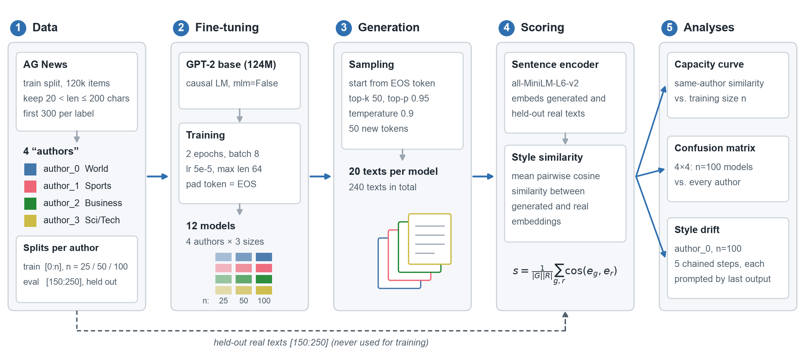

# Supplementary Material: Few-Shot Style Emulation with Fine-Tuned GPT-2

Supplementary files for the paper **"[PAPER TITLE]"** ([AUTHORS], [VENUE, YEAR]).

The experiment fine-tunes GPT-2 (124M) on small samples of text from four AG News categories, each treated as a separate "author". It then measures how close the generated text is to held-out real text using sentence-embedding cosine similarity. The released material covers three analyses: a style capacity curve (25, 50 and 100 training samples), a style confusion matrix, and a style drift test.

## Pipeline



A PDF version for the paper is in `figures/architecture.pdf`. Regenerate both with `python scripts/make_architecture_figure.py`.

## Contents

| Path | What it holds |
|---|---|
| `notebook/micro_style_gpt2.ipynb` | Original Colab notebook with outputs (progress bars and widget state removed, code unchanged) |
| `data/author_splits.json` | AG News row indices for each author, plus the train and evaluation slices |
| `generations/author_{k}_{n}.json` | The 20 texts generated by each of the 12 fine-tuned models (author `k`, `n` training samples) |
| `results/capacity_curve.csv` | Numbers behind the style capacity curve |
| `results/confusion_matrix.csv` | Numbers behind the style confusion matrix (models trained on 100 samples) |
| `figures/` | Pipeline diagram, capacity curve and confusion matrix at 300 dpi (PNG and PDF); style drift figure from the original run |
| `scripts/build_authors.py` | Rebuilds the author corpora from AG News and checks them against `data/author_splits.json` |
| `scripts/evaluate.py` | Recomputes the capacity curve and confusion matrix from `generations/`, writing `results/` and `figures/` |
| `scripts/make_architecture_figure.py` | Draws the pipeline diagram in `figures/architecture.{png,pdf}` |
| `scripts/colab_export.py` | Cell to run in Colab to export the drift values and upload the fine-tuned models to the Hugging Face Hub |

## Data

The "authors" are the four AG News labels:

| Author | AG News label |
|---|---|
| `author_0` | World |
| `author_1` | Sports |
| `author_2` | Business |
| `author_3` | Sci/Tech |

For each label, the notebook takes the first 300 texts (in dataset order) from the AG News training split whose length is between 21 and 200 characters. Models are trained on slice `[0:n]` for `n` in {25, 50, 100}. Evaluation uses slice `[150:250]`, which never overlaps with training data.

AG News text is not included in this repository. `data/author_splits.json` stores row indices into [`fancyzhx/ag_news`](https://huggingface.co/datasets/fancyzhx/ag_news), and `scripts/build_authors.py` rebuilds the exact texts.

## Hyperparameters

| Setting | Value |
|---|---|
| Base model | `gpt2` (124M) |
| Objective | Causal language modeling (`DataCollatorForLanguageModeling`, `mlm=False`) |
| Max sequence length | 64 tokens, padded to max length (pad token = EOS) |
| Epochs | 2 |
| Batch size | 8 |
| Learning rate | 5e-5 |
| Mixed precision | fp16 when a CUDA GPU is available |
| Seed | 42 (`random`, `numpy`, `torch`) |
| Training sizes | 25, 50, 100 samples per author (12 models in total) |
| Generation | Unconditional (starts from EOS), `max_new_tokens=50`, `do_sample=True`, `top_k=50`, `top_p=0.95`, `temperature=0.9` |
| Generations per model | 20 |
| Embedding model | `sentence-transformers/all-MiniLM-L6-v2` |
| Similarity | Mean pairwise cosine similarity between generated and held-out real texts |
| Drift test | `author_0` model trained on 100 samples, 5 steps, each step prompted with the previous step's full output |

## Results

Style capacity curve (similarity to the same author's held-out texts):

| Author | 25 | 50 | 100 |
|---|---|---|---|
| author_0 (World) | 0.0484 | 0.0622 | 0.0567 |
| author_1 (Sports) | 0.0655 | 0.0683 | 0.1058 |
| author_2 (Business) | 0.0655 | 0.0479 | 0.0802 |
| author_3 (Sci/Tech) | 0.0446 | 0.0521 | 0.0536 |

Style confusion matrix (rows: model the text was generated from; columns: author it is compared with):

| | author_0 | author_1 | author_2 | author_3 |
|---|---|---|---|---|
| author_0 | **0.0567** | 0.0386 | 0.0326 | 0.0382 |
| author_1 | 0.0245 | **0.1058** | 0.0363 | 0.0327 |
| author_2 | 0.0404 | 0.0208 | **0.0802** | 0.0763 |
| author_3 | 0.0406 | 0.0194 | 0.0347 | **0.0536** |

Running `scripts/evaluate.py` on the released generations reproduces these values, and they match the figures produced in the original notebook run.

## Reproducing

```bash
python -m venv .venv && source .venv/bin/activate
pip install -r requirements.txt
cd scripts
python build_authors.py   # rebuild author corpora and verify the indices
python evaluate.py        # recompute results/ and figures/
```

To retrain the models and regenerate text, open `notebook/micro_style_gpt2.ipynb` in Google Colab. The notebook saves models and generations to Google Drive and loads them if they already exist, so delete those folders to force a fresh run.

## Fine-tuned models

The 12 fine-tuned checkpoints (about 500 MB each) are hosted on the Hugging Face Hub: [LINK TO BE ADDED].

## Implementation notes

- **Dataset name:** recent versions of `datasets` require the namespaced name `fancyzhx/ag_news`. The notebook uses `ag_news`, which worked in the original Colab environment. Change it if loading fails.
- **Padding and EOS:** padding uses the EOS token, so `DataCollatorForLanguageModeling` sets EOS positions to `-100` in the labels. The models are therefore never trained to emit EOS, and generations always run to `max_new_tokens`.
- **Drift prompts:** in the drift test, each step's prompt is the previous step's decoded output, which already contains all earlier text. Each step's text therefore includes the text of every step before it.
- **Drift values:** the per-step drift values were not saved in the original run, so only the figure is included. `scripts/colab_export.py` exports them from a Colab session. Because generation is sampled, a rerun gives slightly different values.
- **Single run:** all reported numbers come from one seed with 20 generations per model.

## License

Code is released under the MIT License (see `LICENSE`). AG News is subject to its own terms of use and is not redistributed here. The texts in `generations/` were produced by the fine-tuned GPT-2 models and may contain inaccurate or invented statements about real people and events.

## Citation

```bibtex
@article{TODO,
  title  = {[PAPER TITLE]},
  author = {[AUTHORS]},
  year   = {2026}
}
```
